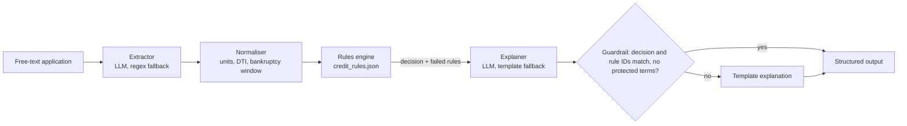

# AI Loan Adjudication

Hybrid personal-loan adjudication: **an LLM reads the free-text application, a deterministic rules engine
makes the decision, and an LLM writes an applicant-facing explanation** that is validated against the
engine before it is released.



Output for every application:

```json
{
  "decision": "REJECT",
  "failed_rules": [{"id": "RULE-CREDIT-001", "name": "Minimum Credit Score", "your_value": "561", "requirement": "at least 670", "...": "..."}],
  "missing_information": [],
  "reasoning": "We are unable to approve your application at this time. Your credit score is 561, but the requirement is at least 670. ..."
}
```

## Why not fine-tune an LLM to make the decision?

The policy is 10 deterministic thresholds. Code evaluates them with 100% accuracy, full auditability and
zero retraining when a threshold changes. The LLM is used only where language understanding is needed:
reading messy narratives and writing a clear explanation. The brief's data-prep requirements (tokenization,
special tokens, padding/truncation, train/val split) are still implemented so a fine-tuning run is a drop-in
option, and an end-to-end learned baseline (TF-IDF + logistic regression) is trained to quantify the gap.
See [REPORT.md](REPORT.md).

## Repository layout

| Path | Purpose |
| --- | --- |
| `data/credit_rules.json` | The provided policy (single source of truth for decisions and prompts) |
| `data/holdout_handwritten.jsonl` | 10 hand-written applications with phrasing *not* produced by the generator |
| `src/loan_adjudication/rules_engine.py` | Generic evaluator for the JSON rule operators, decision precedence |
| `src/loan_adjudication/schema.py` | Canonical fields + normalisation (monthly→annual income, debts→DTI, bankruptcy window) |
| `src/loan_adjudication/synth.py` | Synthetic profiles, scenario mix, edge cases, narrative rendering, counterfactual identities |
| `src/loan_adjudication/extractor.py` | `LLMExtractor` (primary) and `RegexExtractor` (offline baseline / fallback) |
| `src/loan_adjudication/explainer.py` | `LLMExplainer` (policy as system prompt) + guardrail, `TemplateExplainer` |
| `src/loan_adjudication/llm_client.py` | OpenAI-compatible chat client configured from env vars |
| `scripts/prepare_data.py` | Generate → label → stratified split → narratives + dialogues → masked SFT format → tokenize/pad |
| `scripts/train.py` | Learned baselines: original TF-IDF+LR, CV-regularised TF-IDF+LR, facts→decision tree (+ true-facts diagnostic) |
| `scripts/evaluate.py` | Decision, extraction, explanation, fairness and counterfactual metrics |
| `scripts/predict.py` | Adjudicate one application from the CLI |

## Setup

Requires Python 3.11+.

```bash
python3.11 -m venv .venv && source .venv/bin/activate
pip install -e ".[tokenize,dev]"     # 'tokenize' pulls transformers; omit it to skip tokenization
pytest -q
```

### LLM endpoint (optional)

Everything runs offline by default (regex extractor + template explainer). To use an LLM, copy
`.env.example` to `.env` and set the endpoint. Any OpenAI-compatible `/chat/completions` endpoint works,
including an internal gateway:

```bash
cp .env.example .env
# LLM_BASE_URL, LLM_MODEL, LLM_API_KEY, optional LLM_API_KEY_HEADER / LLM_EXTRA_HEADERS / LLM_CA_BUNDLE
```

`.env` is git-ignored; never commit keys or internal URLs.

## Run

```bash
# 1. Data: 2,000 synthetic applications as narratives AND multi-turn intake dialogues, 80/20 stratified split,
#    identity-masked chat-format SFT data, tokenized + padded (loss only on assistant turns)
python scripts/prepare_data.py --n 2000 --seed 42 --tokenizer Qwen/Qwen2.5-0.5B-Instruct
#    --policy-in-prompt full   embed all rules in the system prompt (default: compact instruction, policy learned)
#    --reasoning llm           use guardrail-checked LLM letters as reasoning targets (default: varied templates)
#    No Hugging Face access? Use any locally cached tokenizer (role special tokens are added automatically
#    when it has no chat template), or point HF_ENDPOINT at a mirror, or pass --tokenizer none.
HF_HUB_OFFLINE=1 python scripts/prepare_data.py --tokenizer roberta-large

# 2. Learned baselines (identity-masked text; validation uses held-out wordings, see --wording-split)
python scripts/train.py                         # writes models/*.joblib, reports/training_metrics.json, reports/tree_rules.txt

# 3. Evaluate on the synthetic validation split (auto = LLM if configured, else offline)
python scripts/evaluate.py                      # writes reports/metrics.json, reports/sample_outputs.md
python scripts/evaluate.py --extractor llm --explainer llm --workers 8
python scripts/evaluate.py --data data/processed/dialogues_val.jsonl --out reports/dialogues

# 4. Stress test on hand-written applications
python scripts/evaluate.py --data data/holdout_handwritten.jsonl --out reports/holdout --samples 10

# 5. Single application
python scripts/predict.py "I'm 29, work full-time as a nurse for 3 years, earn \$64,000 a year, credit score 712, DTI 22%, US citizen, never filed for bankruptcy, have a checking account. I'd like to borrow \$10,000."
```

## Key design decisions

- **Decision precedence:** any failed `REJECT` rule → `REJECT`; else any failed `FLAG_REVIEW` rule or any
  unverifiable input → `FLAG_REVIEW`; else `APPROVE`. Severity orders the reasons in the explanation.
- **Missing information is never guessed:** it routes to manual review, so extraction failures fail safe.
- **`RULE-EMPLOY-002` applicability:** tenure is only evaluated for applicants who currently hold a job.
- **Thresholds are inclusive** exactly as written (`credit_score >= 670`, `DTI <= 40`, `amount <= 0.5 × income`).
- **Data minimisation:** the explainer never sees the narrative, name, gender or location, only rule outcomes.
- **Guardrail:** an LLM explanation is used only if its decision and rule IDs match the engine exactly and it
  contains no protected-attribute terms; otherwise the template explanation is returned.
